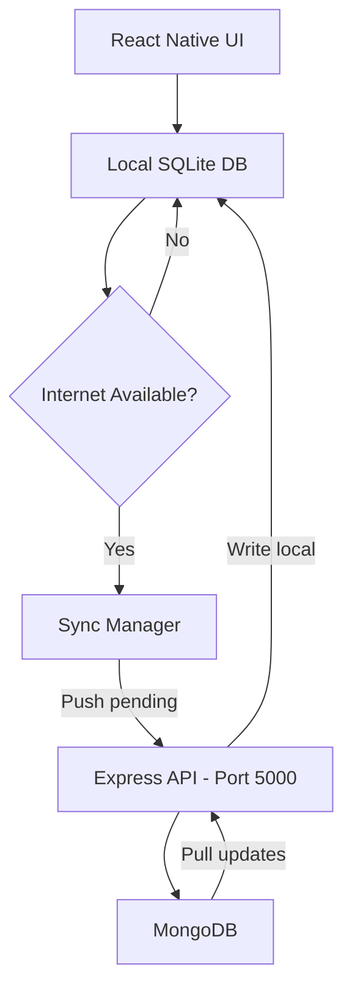

# 🔄 Offline-First Synchronization — Implementation Guide

> **This document describes the actual sync implementation between the React Native mobile app (SQLite + Drizzle) and the Express + MongoDB backend.**

---

## 📂 Architecture



**Scope:** All eight tables — accounts, categories, subcategories, expenses, income, transfers, budgets and fuel logs — sync both ways, including deletions.
The mobile side is [syncEngine.js](src/lib/sync/syncEngine.js) (pure, Node-tested), [syncStores.js](src/lib/sync/syncStores.js) (SQLite and browser localStorage adapters), [localStore.js](src/lib/sync/localStore.js) and [syncManager.js](src/lib/sync/syncManager.js) (app wiring), and [syncMigrations.js](src/lib/db/syncMigrations.js) (schema upgrade).

**Offline:** Every write is saved locally and marked `pending`. Deleting an already-synced row queues a server delete.
**Online:** Queued deletes are sent first, then each table is pushed and pulled in parent-first order.

---

## ⚠️ Field Mapping (Important)

The backend MongoDB models cover all eight mobile SQLite tables. Storage differences:

- **Links use names, not local integer ids.** `accountId` → `accountName`, `fromAccountId`/`toAccountId` → `fromAccountName`/`toAccountName`, `categoryId` → `categoryName`. Local ids differ per device, but account and category names are unique.
- **`remote_id` and `sync_status` are mobile-only bookkeeping.** `remote_id` stores the MongoDB `_id`. Expenses, income and transfers also store `clientId`, the mobile row `id`, to distinguish identical rows on one client.
- **Timestamps:** MongoDB `createdAt` and `updatedAt` are server-managed dates, serialized as ISO strings; SQLite stores text `created_at`. The current mobile client does not send its original creation timestamp.

| Mobile table | MongoDB model (`Backend/Models`) | Server fields | Natural key used when `remoteId` is missing |
|---|---|---|---|
| `expenses` | `expense.js` | title, amount, category, subcategory, accountName, date, description, month, method, imageUri | `clientId + title + month + amount` |
| `income` | `income.js` | title, amount, accountName, source, date, description, month, method | `clientId + title + month + amount` |
| `budgets` | `budget.js` | month (unique), amount | `month` (always) |
| `fuel_logs` | `fuelLog.js` | startKm, odometerKm, litres, pricePerLitre, totalCost, date, month, note | `startKm + date + litres` |
| `accounts` | `account.js` | name (unique), type (Cash/Bank/Card/UPI/Wallet), color, initialBalance | `name` |
| `transfers` | `transfer.js` | fromAccountName, toAccountName, amount (> 0), date, month, note | `clientId + from + to + amount + month` |
| `categories` | `category.js` | name (unique), color | `name` |
| `subcategories` | `subcategory.js` | categoryName, name (unique per category) | `categoryName + name` |

All models have `createdAt`/`updatedAt` timestamps (`updatedAt` drives delta pulls).

Nullable SQLite business fields remain nullable on the server, including expense/income `method`, optional account links, images, fuel end readings and transfer dates. Account defaults are `type = "Cash"` and `initialBalance = 0`. Account types follow the mobile UI: Cash, Bank, Card, UPI, Wallet. Budget months and account/category names are unique; subcategory names are unique within a category (also enforced by the mobile SQL initialization).

**Identity limitation:** Local row ids are not globally unique. Without `remoteId`, identical rows from different devices can still collide, and editing the natural-key fields before receiving an acknowledgement can create another document. The current mobile protocol has no device id or globally unique client record id; reliable multi-device identity needs a later mobile protocol change. Persist and resend `remoteId` after the first acknowledgement.

### References and cascades
- **Write order:** create/sync accounts and categories before records referencing them. Expense/income account names, transfer account names and subcategory parent categories must exist; invalid links are reported as errors, not silently stored. Category/subcategory strings on expenses remain denormalized, including the `"General"` fallback.
- **Delete account:** its expenses/income get `accountName = null`; transfers that use it are deleted.
- **Delete category:** its expenses move to `"General"` with `subcategory = null`; its subcategories are deleted.
- **Rename subcategory (`PUT` or sync):** matching expenses get the new name. **Delete subcategory:** matching expenses get `subcategory = null`.
- **Account/category rename via sync** (same `remoteId`, new name): every record that references the old name is updated.
- **Deliberate correction:** subcategory cascades are scoped to the parent category, so renaming "Meals" under "Food" does not change "Meals" under another category. The current mobile query only matches the subcategory name. Moving an existing subcategory to another parent is rejected (the mobile UI supports renaming, not moving).
- Cascades use separate MongoDB writes, like the mobile queries; they are not multi-collection transactions.

---

## 🛤️ Backend Sync API Endpoints

Every entity uses the same protocol:

**`POST /<route>/sync`**: push pending mobile rows
```javascript
// Request body:  { <bodyKey>: [{ id, remoteId, ...fields }] }
// Response:      { success, syncedIds: [{ localId, remoteId }], failed: [{ localId, error }] }
```
- Matches by `remoteId` when present. Otherwise it matches by the natural key above, then upserts.
- Only the fields listed above are written, and only when they are present in the payload. An older client that sends a subset of fields will not erase the others.
- Each item is validated on its own. Invalid items are listed in `failed` and do not abort the batch. `success` is `false` when any item failed.
- Local `id` must be a positive number (fractional web-generated ids are supported). Invalid `remoteId` values are rejected, except budgets which deliberately match only by month.
- Retrying an unchanged natural-key payload matches the same record in sequential requests. This is not a conflict-resolution or exactly-once protocol.

**`GET /<route>/delta?since=<epoch-ms>`**: pull changes
```javascript
// Response: { items: [{ _id, ...fields, createdAt, updatedAt }], timestamp, activeIds: ["..."] }
```
- `items` contains records with `updatedAt >= since`. The boundary is included to avoid losing writes in the same millisecond as the previous cursor; clients already upsert by `_id`, so repeats are safe. `activeIds` lists every live `_id`, which the client uses to detect deletions.
- `since` must be a non-negative integer epoch-millisecond timestamp within JavaScript's date range. Invalid timestamps return HTTP 400. The response cursor is captured before querying.
- **Budgets are always a full pull** (`since` is ignored), because the mobile app detects budget deletions by month.

| Entity | Route | `bodyKey` | Extra REST endpoints |
|---|---|---|---|
| Expenses | `/expenses` | `expenses` | `GET /?month=&accountName=`, `POST /`, `PUT /:id`, `DELETE /:id`, `GET /history` |
| Income | `/income` | `income` | `GET /?month=&accountName=`, `POST /`, `PUT /:id`, `DELETE /:id` |
| Budgets | `/budget` | `budgets` | `GET /?month=`, `POST /` |
| Fuel logs | `/fuel` | `fuelLogs` | `GET /`, `POST /`, `PATCH /:id/end-reading`, `DELETE /:id`, `GET /stats` |
| Accounts | `/accounts` | `accounts` | `GET /`, `GET /balances`, `POST /`, `DELETE /:id` |
| Transfers | `/transfers` | `transfers` | `GET /?month=`, `POST /`, `DELETE /:id` |
| Categories | `/categories` | `categories` | `GET /` (with nested `subcategories`), `POST /`, `DELETE /:id` |
| Subcategories | `/subcategories` | `subcategories` | `GET /?categoryName=`, `POST /`, `PUT /:id`, `DELETE /:id` |

### Mobile sync implementation

**Order:** queued deletes (children first) → accounts → categories → subcategories → expenses → income → transfers → budgets → fuel logs. Each table is pushed (`POST /<route>/sync`, batches of 100) and then pulled (`GET /<route>/delta?since=<cursor>`).

**Local bookkeeping:** every table has `remote_id` and `sync_status` (`pending` | `synced`). `sync_meta` stores per-table cursors and one-time upgrade flags. `sync_deletes` stores queued server deletes. On web the same data lives in localStorage keys `sync_meta` and `sync_deletes`, and subcategories stay nested in `categories`.

**Ids and references:** the server links rows by name, while the app uses local integer ids. On push, `accountId`, `fromAccountId`, `toAccountId` and `categoryId` are sent as names; on pull they are mapped back to local ids. Accounts and categories are matched by name, subcategories by category and name (case-insensitive), and budgets by month. Rows without a natural key get a client-generated 24-hex id before their first upload, so a retry after a lost response updates the same document instead of creating a duplicate.

**Conflicts:** a row is marked `synced` only if it still matches the version that was uploaded; an edit made during the request stays `pending`. Pulls never overwrite a `pending` row; the local edit is uploaded instead, so the last write accepted by the server wins. Remote category and subcategory renames are applied to expense text fields.

**Deletes:** local deletes use the same cascades as the server (via `removeWithCascade`):
- Deleting an account clears expense and income links and deletes its transfers.
- Deleting a category moves its expenses to "General" and deletes its subcategories.
- Deleting a subcategory clears it only on its parent category's expenses.

Affected rows become `pending`. A `404` on delete counts as already deleted. Rows missing from `activeIds` are removed locally unless they are pending. A remotely deleted account, category or subcategory that still has pending local rows is re-uploaded instead of being removed.

**Failures:** a network error or 60-second timeout stops the pass and keeps the queues and cursors. A rejected row stays `pending` and is reported. A table's cursor only advances when every downloaded item was applied.

**Upgrade:** on first launch the migration adds missing columns and tables in a single transaction. It also recovers fuel logs stranded in `fuel_logs_old` by the previous migration, which renamed the table and then failed. Existing expenses are re-uploaded once so the server receives the fields the old manager never sent.

**Limitations:**
- `imageUri` is synced as text only; the image file is not uploaded.
- Budgets cannot be deleted (there is no delete in the app or on the server).
- Default categories and the "Cash" account seeded on a new device are merged by name. They can bring back a default that another device deleted.
- There is no authentication or per-user data isolation.

---

## 📱 Mobile SQLite Schema

[schema.js](src/lib/db/schema.js) is the source of truth. All eight tables include `remoteId: text('remote_id')` and `syncStatus: text('sync_status').default('pending')`; the backend contract test ignores these bookkeeping fields. The runtime `CREATE TABLE` and `ALTER TABLE` statements are in [syncMigrations.js](src/lib/db/syncMigrations.js).

---

## 🔄 Mobile Sync Manager (`src/lib/sync/syncManager.js`)

- `API_URL`: `EXPO_PUBLIC_API_URL` (for example `https://<service>.onrender.com`). In development it falls back to the local backend on port 5000.
- `syncAll()`: syncs every table. Concurrent calls share one pass, and a change made during a pass triggers one more pass. It never rejects; it resolves to `{ ok, offline, pushed, pulled, removed, deleted, errors }`.
- `startAutoSync()`: called by [_layout.jsx](src/app/_layout.jsx) once the database is ready. It syncs when the device comes online, and 2 seconds after any local write (every mutation in [queries.js](src/lib/db/queries.js) calls `notifyLocalChange()`).
- The drawer's manual sync reports success, offline, or how many items failed.

Run the mobile tests (the sync suite uses in-memory SQLite, localStorage and a fake backend):

```powershell
node --experimental-vm-modules --test src\lib\sync\syncEngine.test.mjs src\lib\backup\portableData.test.mjs src\lib\reports\monthlyReportData.test.mjs
```

---

## Backend validation

Run from `Expense\Gsap_Tutorial\Backend`:

```powershell
node --test tests\contract.test.js
```

This offline suite compares the actual mobile schema's fields, scalar types, nullability and defaults with all eight Mongoose models. It also exercises the real route handlers with explicit database mocks: full-field sync payloads, legacy partial payloads, errors, delta shapes, name-reference checks, cascades and the mobile balance formula. It is **not** a substitute for real MongoDB tests.

With a throwaway local MongoDB running:

```powershell
$env:TEST_MONGO_URI = "mongodb://127.0.0.1:27017"
node --test tests\integration.test.js
```

The integration suite uses the Express app over HTTP and real Mongoose writes/indexes. It covers all eight push/retry/pull round trips, existing web APIs, field preservation, invalid rows, delta boundaries, account balances and cascades. It creates and drops a uniquely named `expense_backend_test_*` database. It only accepts loopback MongoDB addresses and never loads `.env` or uses `MONGODB_URI`. Do not change it to target a deployed database.

Equivalent package scripts are `npm test` and `npm run test:integration`. Tests require no new dependencies. The offline suite needs the sibling Mobile checkout so it can read the source schema.

`App.js` registers routes without starting a listener or connecting to a database, for test isolation. `Server.js` remains the production entry point; it waits for MongoDB (`MONGODB_URI`) before listening and exits unsuccessfully if the connection fails.

---

## ☁️ Render deployment and keep-alive

Create a Render **Web Service** (Node runtime) from the backend repository with build command `npm ci --omit=dev`, start command `npm start`, and environment variables `MONGODB_URI` (an externally reachable MongoDB such as Atlas) and `NODE_VERSION=24`. Render supplies `PORT`; `Server.js` already uses it.

`GET /health` (and `HEAD /health`) is an unauthenticated liveness probe returning `{ "status": "ok", "uptime": <seconds>, "database": "connected" | "disconnected" | ... }` with `Cache-Control: no-store`. It never queries the database, and always answers `200` while the process is running, so a brief database reconnect does not restart the service.

- Set the service's **Health Check Path** to `/health` so Render can verify new deploys.
- Render's free web services spin down after 15 minutes without inbound traffic. Render's own health checks are for deploy and restart decisions, and are not documented as traffic that prevents spin-down. To keep the instance awake, configure an external monitor (for example UptimeRobot or cron-job.org) to request `https://<service>.onrender.com/health` at least every 10 minutes. A free instance can also restart at any time and has an ephemeral filesystem; this API stores nothing locally.
- Mobile release builds need `EXPO_PUBLIC_API_URL=https://<service>.onrender.com`; without it a release build stays offline-only.
- There is no authentication or per-user data isolation yet; add it before storing real financial data on a public URL.

---

## 🤖 Instructions for AI Coding Assistants

When you receive this file:
1. The mobile SQLite schema (`src/lib/db/schema.js`) is the source of truth. The Mongoose models in `Backend/Models` mirror it, using the name-based links described in "Field Mapping".
2. When you add a mobile column or table, add it to the matching Mongoose model, the route's selected fields and the backend contract-test fixtures.
3. Register sync endpoints with `registerSyncRoutes` from `Backend/Utils/sync.js` (POST /sync, GET /delta).
4. Resolve local integer ids (accountId, categoryId) to names before pushing, and map names back to local ids after pulling.
5. Budgets are always a full pull (the mobile app detects deletions by month). Every other entity uses `updatedAt` delta + `activeIds`.
6. Rename and delete cascades for name-based links are in `Backend/Utils/cascade.js`. Keep them in line with `src/lib/db/queries.js`.
