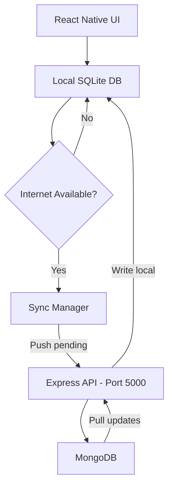

# 🔄 Offline-First Synchronization — Implementation Guide

> **This document describes the actual sync implementation between the React Native mobile app (SQLite + Drizzle) and the Express + MongoDB backend.**

---

## 📂 Architecture



**Scope:** Backend alignment only; no mobile runtime or SQLite migrations were changed.
The comparison uses [schema.js](src/lib/db/schema.js), the SQL initialization/migrations and business rules in [queries.js](src/lib/db/queries.js), and the actual payloads in [syncManager.js](src/lib/sync/syncManager.js).

**Offline:** Data saves locally. Expenses, income, budgets and fuel logs have sync bookkeeping; accounts, transfers, categories and subcategories do not.
**Online today:** The mobile sync manager pushes/pulls expenses (only title, amount, month, method), budgets and fuel logs. Backend support for the other fields/tables does **not** make the unchanged mobile client sync them.

---

## ⚠️ Field Mapping (Important)

The backend MongoDB models cover all eight mobile SQLite tables. Storage differences:

- **Links use names, not local integer ids.** `accountId` → `accountName`, `fromAccountId`/`toAccountId` → `fromAccountName`/`toAccountName`, `categoryId` → `categoryName`. Local ids differ per device, but account and category names are unique.
- **`remote_id` and `sync_status` are mobile-only bookkeeping.** `remote_id` stores the MongoDB `_id`. Expenses, income and transfers also store `clientId`, the mobile row `id`, to distinguish identical rows on one client.
- **Timestamps:** MongoDB `createdAt` and `updatedAt` are server-managed dates, serialized as ISO strings; SQLite stores text `created_at`. The current mobile client does not send its original creation timestamp.

| Mobile table | MongoDB model (`Backend/Models`) | Server fields | Natural key used when `remoteId` is missing |
|---|---|---|---|
| `expenses` | `expense.js` | title, amount, category, subcategory, accountName, date, description, month, method, imageUri | `clientId + title + month + amount` |
| `income` | `income.js` | title, amount, accountName, source, date, description, month, method | `clientId + title + month + amount` |
| `budgets` | `budget.js` | month (unique), amount | `month` (always) |
| `fuel_logs` | `fuelLog.js` | startKm, odometerKm, litres, pricePerLitre, totalCost, date, month, note | `startKm + date + litres` |
| `accounts` | `account.js` | name (unique), type (Cash/Bank/Card/UPI/Wallet), color, initialBalance | `name` |
| `transfers` | `transfer.js` | fromAccountName, toAccountName, amount (> 0), date, month, note | `clientId + from + to + amount + month` |
| `categories` | `category.js` | name (unique), color | `name` |
| `subcategories` | `subcategory.js` | categoryName, name (unique per category) | `categoryName + name` |

All models have `createdAt`/`updatedAt` timestamps (`updatedAt` drives delta pulls).

Nullable SQLite business fields remain nullable on the server, including expense/income `method`, optional account links, images, fuel end readings and transfer dates. Account defaults are `type = "Cash"` and `initialBalance = 0`. Account types follow the mobile UI: Cash, Bank, Card, UPI, Wallet. Budget months and account/category names are unique; subcategory names are unique within a category (also enforced by the mobile SQL initialization).

**Identity limitation:** Local row ids are not globally unique. Without `remoteId`, identical rows from different devices can still collide, and editing the natural-key fields before receiving an acknowledgement can create another document. The current mobile protocol has no device id or globally unique client record id; reliable multi-device identity needs a later mobile protocol change. Persist and resend `remoteId` after the first acknowledgement.

### References and cascades
- **Write order:** create/sync accounts and categories before records referencing them. Expense/income account names, transfer account names and subcategory parent categories must exist; invalid links are reported as errors, not silently stored. Category/subcategory strings on expenses remain denormalized, including the `"General"` fallback.
- **Delete account:** its expenses/income get `accountName = null`; transfers that use it are deleted.
- **Delete category:** its expenses move to `"General"` with `subcategory = null`; its subcategories are deleted.
- **Rename subcategory (`PUT` or sync):** matching expenses get the new name. **Delete subcategory:** matching expenses get `subcategory = null`.
- **Account/category rename via sync** (same `remoteId`, new name): every record that references the old name is updated.
- **Deliberate correction:** subcategory cascades are scoped to the parent category, so renaming "Meals" under "Food" does not change "Meals" under another category. The current mobile query only matches the subcategory name. Moving an existing subcategory to another parent is rejected (the mobile UI supports renaming, not moving).
- Cascades use separate MongoDB writes, like the mobile queries; they are not multi-collection transactions.

---

## 🛤️ Backend Sync API Endpoints

Every entity uses the same protocol:

**`POST /<route>/sync`**: push pending mobile rows
```javascript
// Request body:  { <bodyKey>: [{ id, remoteId, ...fields }] }
// Response:      { success, syncedIds: [{ localId, remoteId }], failed: [{ localId, error }] }
```
- Matches by `remoteId` when present. Otherwise it matches by the natural key above, then upserts.
- Only the fields listed above are written, and only when they are present in the payload. An older client that sends a subset of fields will not erase the others.
- Each item is validated on its own. Invalid items are listed in `failed` and do not abort the batch. `success` is `false` when any item failed.
- Local `id` must be a positive number (fractional web-generated ids are supported). Invalid `remoteId` values are rejected, except budgets which deliberately match only by month.
- Retrying an unchanged natural-key payload matches the same record in sequential requests. This is not a conflict-resolution or exactly-once protocol.

**`GET /<route>/delta?since=<epoch-ms>`**: pull changes
```javascript
// Response: { items: [{ _id, ...fields, createdAt, updatedAt }], timestamp, activeIds: ["..."] }
```
- `items` contains records with `updatedAt >= since`. The boundary is included to avoid losing writes in the same millisecond as the previous cursor; clients already upsert by `_id`, so repeats are safe. `activeIds` lists every live `_id`, which the client uses to detect deletions.
- `since` must be a non-negative integer epoch-millisecond timestamp within JavaScript's date range. Invalid timestamps return HTTP 400. The response cursor is captured before querying.
- **Budgets are always a full pull** (`since` is ignored), because the mobile app detects budget deletions by month.

| Entity | Route | `bodyKey` | Extra REST endpoints |
|---|---|---|---|
| Expenses | `/expenses` | `expenses` | `GET /?month=&accountName=`, `POST /`, `PUT /:id`, `DELETE /:id`, `GET /history` |
| Income | `/income` | `income` | `GET /?month=&accountName=`, `POST /`, `PUT /:id`, `DELETE /:id` |
| Budgets | `/budget` | `budgets` | `GET /?month=`, `POST /` |
| Fuel logs | `/fuel` | `fuelLogs` | `GET /`, `POST /`, `PATCH /:id/end-reading`, `DELETE /:id`, `GET /stats` |
| Accounts | `/accounts` | `accounts` | `GET /`, `GET /balances`, `POST /`, `DELETE /:id` |
| Transfers | `/transfers` | `transfers` | `GET /?month=`, `POST /`, `DELETE /:id` |
| Categories | `/categories` | `categories` | `GET /` (with nested `subcategories`), `POST /`, `DELETE /:id` |
| Subcategories | `/subcategories` | `subcategories` | `GET /?categoryName=`, `POST /`, `PUT /:id`, `DELETE /:id` |

### Mobile follow-up (not yet implemented in `syncManager.js`)
The backend accepts every mobile field. To sync all of them, `syncManager.js` still needs to:
1. Send the remaining expense fields: `category`, `subcategory`, `date`, `description`, `imageUri`, and `accountName` (look up `accountId` → `accounts.name`).
2. Add `syncIncome()`. The `income` table already has `remote_id` and `sync_status`.
3. Add `remote_id` and `sync_status` to `accounts`, `categories`, `subcategories`, and `transfers`, then sync them in this order: accounts → categories → subcategories → expenses / income / transfers → budgets → fuel. When pulling, map names back to local ids.
4. Apply the new fields on expense pulls as well as pushes. `imageUri` is stored as metadata only; a phone-local URI is not an uploaded image and is not readable on another device.
5. Add deletion tracking/pushes. Current local deletes are not sent to the backend; `activeIds` only reconciles server-to-client deletions.

---

## 📱 Mobile SQLite Schema (excerpt)

The complete eight-table field mapping is above; [schema.js](src/lib/db/schema.js) remains the source of truth. This excerpt shows the three tables the current mobile sync manager uses.

```javascript
export const expenses = sqliteTable('expenses', {
  id: integer('id').primaryKey({ autoIncrement: true }),
  remoteId: text('remote_id'),           // MongoDB _id
  title: text('title').notNull(),
  amount: real('amount').notNull(),
  category: text('category'),            // On server too — not pushed by syncManager yet
  accountId: integer('account_id'),      // Map to accountName before pushing
  subcategory: text('subcategory'),
  date: text('date'),                    // On server too — not pushed by syncManager yet
  description: text('description'),      // On server too — not pushed by syncManager yet
  month: text('month').notNull(),
  method: text('method'),
  imageUri: text('image_uri'),
  syncStatus: text('sync_status').default('pending'),
  createdAt: text('created_at').default(sql`CURRENT_TIMESTAMP`),
});

export const budgets = sqliteTable('budgets', {
  id: integer('id').primaryKey({ autoIncrement: true }),
  remoteId: text('remote_id'),           // MongoDB _id
  amount: real('amount').notNull(),
  month: text('month').notNull().unique(),
  syncStatus: text('sync_status').default('pending'),
  createdAt: text('created_at').default(sql`CURRENT_TIMESTAMP`),
});

export const fuelLogs = sqliteTable('fuel_logs', {
  id: integer('id').primaryKey({ autoIncrement: true }),
  remoteId: text('remote_id'),           // MongoDB _id
  startKm: real('start_km').notNull(),
  odometerKm: real('odometer_km'),       // nullable — end reading added later
  litres: real('litres').notNull(),
  pricePerLitre: real('price_per_litre').notNull(),
  totalCost: real('total_cost').notNull(),
  date: text('date').notNull(),
  month: text('month').notNull(),
  note: text('note'),
  syncStatus: text('sync_status').default('pending'),
  createdAt: text('created_at').default(sql`CURRENT_TIMESTAMP`),
});
```

---

## 🔄 Mobile Sync Manager (`src/lib/sync/syncManager.js`)

Three exported functions:

### `syncExpenses()`
1. **Push:** Queries SQLite for `sync_status = 'pending'` expenses
2. Sends only `{ id, remoteId, title, amount, month, method }` to `POST /expenses/sync`
3. Server upserts into MongoDB and returns `syncedIds` with MongoDB `_id`
4. Updates local SQLite: sets `sync_status = 'synced'` and stores `remote_id`
5. **Pull:** Fetches `GET /expenses/delta?since=<lastSync>` for new server records
6. Upserts into SQLite with `sync_status = 'synced'`

### `syncBudgets()`
1. **Push:** Same pattern as expenses but for budgets
2. Sends `{ id, remoteId, amount, month }` to `POST /budget/sync`
3. **Pull:** Fetches `GET /budget/delta` — pulls ALL budgets to reconcile deletions by month (the backend now has timestamps)
4. Upserts by `month` uniqueness

### `syncFuelLogs()`
1. **Push:** Queries SQLite for `sync_status = 'pending'` fuel logs
2. Sends all fuel fields to `POST /fuel/sync`
3. Server upserts into MongoDB and returns `syncedIds` with MongoDB `_id`
4. Updates local SQLite: sets `sync_status = 'synced'` and stores `remote_id`
5. **Pull:** Fetches `GET /fuel/delta?since=<lastSync>` for new/updated server records
6. Upserts into SQLite with `sync_status = 'synced'`
7. **Deletion reconciliation:** Removes local synced records whose `remoteId` is no longer in `activeIds`

### `syncAll()`
```javascript
export const syncAll = async () => {
  await syncExpenses();
  await syncBudgets();
  await syncFuelLogs();
};
```

---

## 🛰️ Auto-Sync Setup

To automatically trigger sync when the device comes online, install NetInfo and add a listener in your root layout:

```bash
npx expo install @react-native-community/netinfo
```

```javascript
// In src/app/_layout.jsx
import NetInfo from '@react-native-community/netinfo';
import { useEffect } from 'react';
import { syncAll } from '../lib/sync/syncManager';

// Inside your layout component:
useEffect(() => {
  const unsubscribe = NetInfo.addEventListener(state => {
    if (state.isConnected && state.isInternetReachable) {
      syncAll();
    }
  });
  return () => unsubscribe();
}, []);
```

---

## Backend validation

Run from `Expense\Gsap_Tutorial\Backend`:

```powershell
node --test tests\contract.test.js
```

This offline suite compares the actual mobile schema's fields, scalar types, nullability and defaults with all eight Mongoose models. It also exercises the real route handlers with explicit database mocks: full-field sync payloads, legacy partial payloads, errors, delta shapes, name-reference checks, cascades and the mobile balance formula. It is **not** a substitute for real MongoDB tests.

With a throwaway local MongoDB running:

```powershell
$env:TEST_MONGO_URI = "mongodb://127.0.0.1:27017"
node --test tests\integration.test.js
```

The integration suite uses the Express app over HTTP and real Mongoose writes/indexes. It covers all eight push/retry/pull round trips, existing web APIs, field preservation, invalid rows, delta boundaries, account balances and cascades. It creates and drops a uniquely named `expense_backend_test_*` database. It only accepts loopback MongoDB addresses and never loads `.env` or uses `Railway_Mongo_Uri`. Do not change it to target a deployed database.

Equivalent package scripts are `npm test` and `npm run test:integration`. Tests require no new dependencies. The offline suite needs the sibling Mobile checkout so it can read the source schema.

`App.js` registers routes without starting a listener or connecting to a database, for test isolation. `Server.js` remains the production entry point; it waits for MongoDB before listening and exits unsuccessfully if the connection fails.

---

## 🤖 Instructions for AI Coding Assistants

When you receive this file:
1. The mobile SQLite schema (`src/lib/db/schema.js`) is the source of truth. The Mongoose models in `Backend/Models` mirror it, using the name-based links described in "Field Mapping".
2. When you add a mobile column or table, add it to the matching Mongoose model, the route's selected fields and the backend contract-test fixtures.
3. Register sync endpoints with `registerSyncRoutes` from `Backend/Utils/sync.js` (POST /sync, GET /delta).
4. Resolve local integer ids (accountId, categoryId) to names before pushing, and map names back to local ids after pulling.
5. Budgets are always a full pull (the mobile app detects deletions by month). Every other entity uses `updatedAt` delta + `activeIds`.
6. Rename and delete cascades for name-based links are in `Backend/Utils/cascade.js`. Keep them in line with `src/lib/db/queries.js`.
